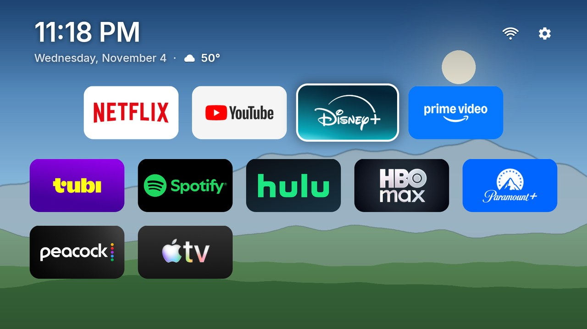
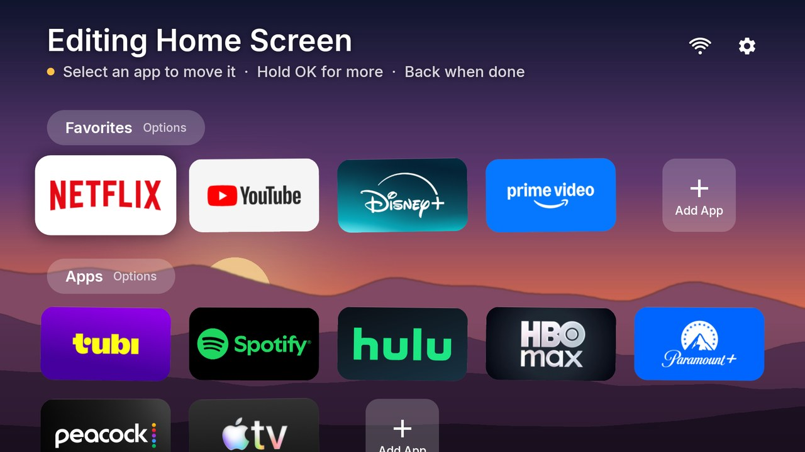
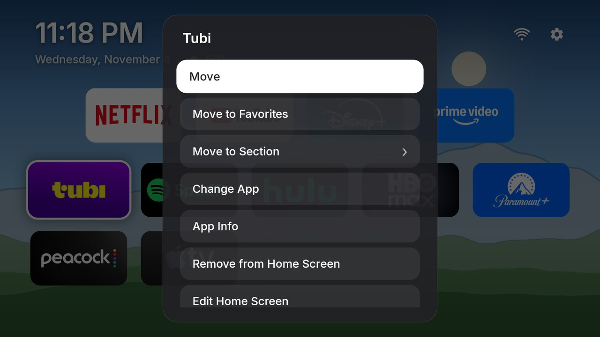
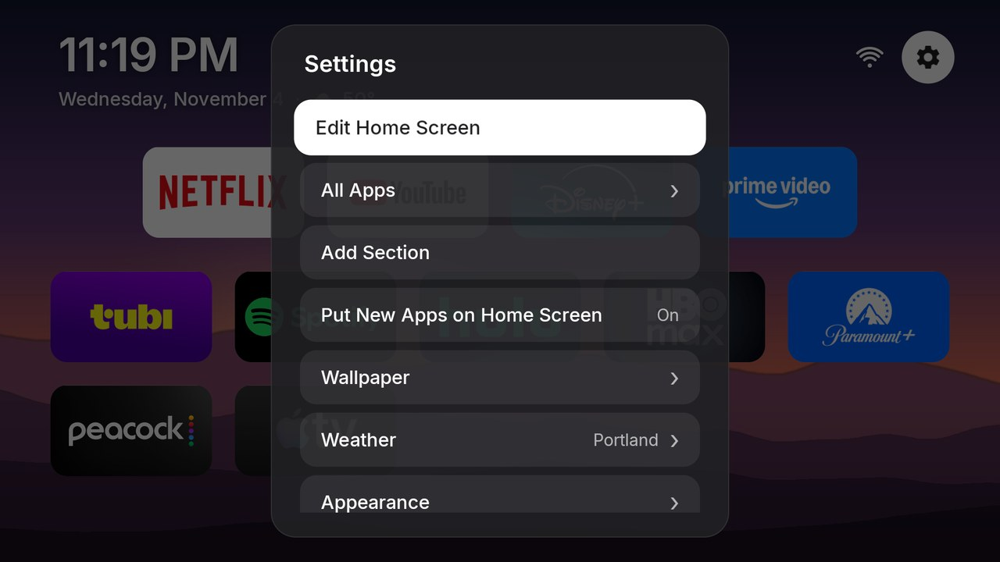
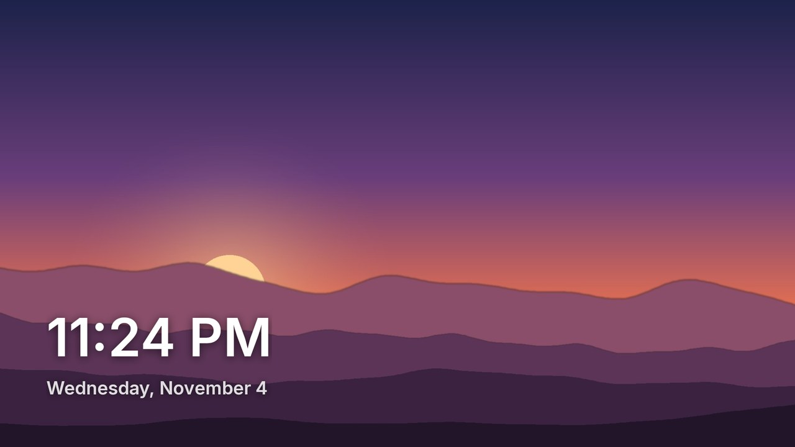

# Waffle


**A simple, friendly home screen for Android TV.** It's free and open source (MIT), with no account,
no ads and no tracking. It doesn't put its own name or logo all over your screen either: the home
screen is just your apps, the time and your photos.



## What it does

- **Your apps, your way.** A row of big favorites on top, then everything else in a tidy
  centered grid. Each section picks how many apps fit across (2 to 8; the tiles size themselves to
  fill the row) and whether a short row lines up left, center or right. Move apps around or into
  other sections, and add, rename or reorder sections.
- **Familiar editing.** Hold OK on an app for its options (Move, Move to Favorites, Move to
  Section, Change App, App Info, Remove). Or choose **Edit Home Screen**: the tiles wiggle
  like on Apple TV, OK picks one up, the arrows move it, and OK puts it down. A one-time tip
  explains this.
- **New apps show up by themselves.** Apps you remove stay removed. **All Apps** in Settings lists
  everything installed.
- **Clock, weather and network status** at the top. Weather comes from
  [Open-Meteo](https://open-meteo.com), with no API key or account: type your town once and get
  current conditions plus a six-day forecast.
- **Your photos as the wallpaper.** They crossfade every few minutes (or in shuffle). Not
  feeling this one? Press **fast-forward ⏩** on the remote for the next picture, or **rewind ⏪**
  to go back (you can turn this off in Settings → Wallpaper). Add them from your phone: the TV
  shows a QR code, you scan it, pick photos, and they appear on the TV.
- **Photos for the time of day.** Mark photos as Morning, Day, Evening or Night (on the TV, or
  with chips on the phone page) and they show only then. Times follow the real sunrise and sunset
  for your weather location, worked out on the TV with no extra service. Unmarked photos fill in
  whenever no photo is set for that time.
- **A matching screensaver.** The same photos as a slow slideshow with the time, and a clock that
  moves now and then so nothing burns in.
- **Comfortable for everyone.** Large text, the Inter typeface, a soft focus "lift", plain
  wording, and screen-reader names on everything.

| Editing | Options for an app |
| --- | --- |
|  |  |
| **Settings** | **Screensaver** |
|  |  |

So far it has only been tested on LineageOS (22.2, Android 15, on an NVIDIA Shield TV). It needs
Android 9 or later, but other Android TV and Google TV devices haven't been tried yet.

## Install

Download the APK from [Releases](https://github.com/barrettcoats/waffle-tv-launcher/releases) and install it
with adb (or build it yourself with `./gradlew assembleRelease`):

```sh
adb install -r waffle-<version>.apk
```

Then make it the home screen. On most TVs that's **Settings → Apps → Default apps → Home app**,
or from adb:

```sh
adb shell cmd package set-home-activity com.barrettcoats.waffle/.MainActivity
```

Releases are signed with this certificate (SHA-256). Check it with `apksigner verify --print-certs`:

    A5:D5:D0:C0:67:07:60:69:15:2F:BE:BF:30:88:EC:33:03:80:B1:2D:2F:9E:8A:10:EE:E8:AC:69:BC:CA:A3:40

Builds made without the signing key fall back to the debug key, so they can't be installed over a
release (or the other way round) without uninstalling first, which clears your layout and photos.

### First steps

1. **Weather:** select **Weather** next to the clock and type your town.
2. **Photos:** Settings (gear) → Wallpaper → **Add Photos from Your Phone**. With no photos, a
   sky gradient is shown.
3. **Arrange:** hold OK on any app, or Settings → **Edit Home Screen**.
4. **Screensaver (optional):** Settings → Wallpaper → **Use as Screensaver**.
5. **Times of day (optional):** Settings → Wallpaper → **Times of Day**. Without a weather
   location it uses plain clock hours.

If weather or phone uploads say *Internet Access Is Off*, the TV is blocking network access for
the launcher. That's a privacy default on LineageOS. Turn on **Network access** in the app's
App Info; the message has a button for it.

## Privacy

- Weather requests go to Open-Meteo with the coordinates of the place you chose, and nothing
  else.
- The phone-upload page runs only while its screen is open on the TV. It needs the 4-digit code
  shown there and only accepts images. It isn't reachable from outside your network.
- No analytics, crash reporting services or accounts. Crash details stay on the TV (Settings →
  About → Diagnostics).

## Development

Kotlin, Jetpack Compose for TV and kotlinx.serialization. The layout is a JSON file in the app's
private storage.

- `data/LayoutOps.kt`: layout edits as pure functions, unit-tested
  (`./gradlew testDebugUnitTest`)
- `data/Weather.kt`, `data/PhotoUploadServer.kt`, `data/Wallpapers.kt`
- `data/SunClock.kt` (sun position → morning/day/evening/night), `data/WallpaperPool.kt`
- `ui/LauncherScreen.kt` (home screen and menus), `ui/TileGrid.kt` (centered column grid)
- `WallpaperDream.kt` (screensaver)

**Something not working on a TV?** See [DEBUGGING.md](DEBUGGING.md): the on-screen Diagnostics
page, logs (`adb logcat -s Waffle`), crash reports, editing the layout file, and known TV
quirks.

## License

MIT, see [LICENSE](LICENSE). Bundled and linked third-party code: the Inter typeface (SIL OFL
1.1), NanoHTTPD (BSD-3-Clause), ZXing (Apache-2.0) and AndroidX/Kotlin libraries (Apache-2.0).
See [licenses/](licenses/).
